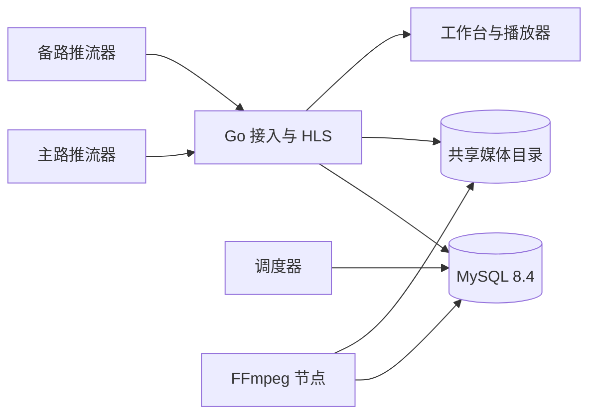

# Media Stream · 分布式直播与点播平台

Media Stream 用 Go 管理直播会话、分片索引和处理队列，FFmpeg 负责转码与剪辑，MySQL 8.4 保存输入代际、租约和发布记录。运营人员可以预约节目、管理主备输入、监看直播、发布回放，并将指定时段导出为带独立授权的剪辑。

## 操作与故障恢复

| 业务 | 能做什么 |
| --- | --- |
| 频道 | 预约时间窗、独立推流和播放身份、短期凭据轮换 |
| 输入 | 每路独立时钟、有效帧检测、超时接管、导播切换、旧代际拒绝 |
| 处理 | 720p/360p 或 360p/240p、节点并发上限、作业续约、过期接管、清单降级 |
| 播放 | HLS 自适应、指定清晰度、字节范围、切换断点、浏览器监看 |
| 回放 | 映射源时钟与媒体时钟、真实分片索引、封存回读、期限管理 |
| 剪辑 | WebVTT 多语种轨、有效区间检查、逐帧取整、重定位字幕、MP4 下载 |
| 质量 | 源切换、转码状态、出口流量、播放器起播和卡顿分别计量 |
| 内容运营 | 单条或批量下架和到期、可恢复的逐项回执、剪辑独立授权、待处理引用保护、多进程存储回收 |

源片先持久化并通过解码检查，调度器为每个会话选择单一输入代际。转码节点以带租约的作业读取源片，只有当前代际和当前租约可以推进播放水位。每个片段保留输入时钟、源间隙、媒体时间、长度和 SHA-256，可用于追溯直播、回放和剪辑之间的关系。

## 从空库开始

需要 Go 1.26、MySQL 8.4 和带 libx264/AAC 的 FFmpeg。发行包内有预编译程序，编译安装可运行 `go build -trimpath ./cmd/media-stream`。详细的初始化、两路推送和回放步骤见 [快速开始](docs/quickstart.md)。

- [接口与媒体协议](docs/api.md)
- [配置、升级和备份恢复](docs/operations.md)
- [验收方法与已测结果](docs/validation.md)
- [原始需求与 16 项验收场景](docs/requirements/04-验收与运营-prd.md)
- [贡献指南](CONTRIBUTING.md) · [安全反馈](SECURITY.md) · [第三方依赖](THIRD_PARTY.md)

源码使用 Apache License 2.0。安装者自行提供 FFmpeg。可以直接使用[三分钟合成影音样片](examples/studio-sample-180s.mp4)，或用命令生成适合两档直播测试的 720p 素材。
